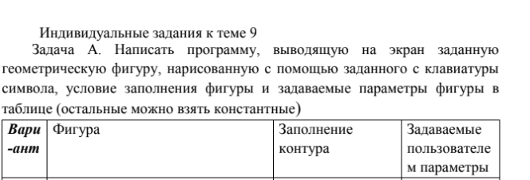
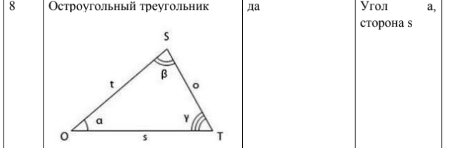

# Домашнее задание к lab9
### вариант 8
### Задача



### Решение

```
#define _CRT_SECURE_NO_DEPRECATE
#include <locale.h>
#include <stdio.h>
#include <string.h> 
#include <stdlib.h>
int main() 
{
    setlocale(LC_ALL, "ru_RU.UTF-8");
    char sim;
    double a;
    int s;
    int choice;
    do {
        printf("Введите символ из которого будет строится фигура: ");
        scanf(" %c", &sim);
        printf("Введите угол a (острый): ");
        scanf("%lf", &a);
        printf("Введите сторону s: ");
        scanf("%d", &s);
        int h = (int)(s * tan(a * 3.14159 / 180) / 2);
        if (h < 2) h = 2;
        printf("\n");
        for (int i = 0; i < h; i++)
        {
            int chir = (i + 1) * s / h;
            int ots = (s - chir) / 2;
            for (int j = 0; j < ots; j++)
                printf(" ");
            for (int j = 0; j < chir; j++)
                printf("%c", sim);
            printf("\n");
        }
        printf("\nПродолжить? (1 - да, 0 - нет): ");
        scanf("%d", &choice);
    } while (choice == 1);
}
```

### Вывод
В ходе выполнения задания была разработана программа, которая рисует на экране остроугольный треугольник из заданного пользователем символа, угла и стороны треугольника.

### Информация о разработчике
Толстоброва Вероника Олеговна бТИИ-262
